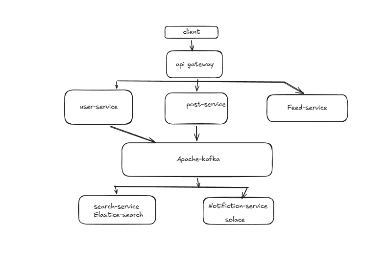
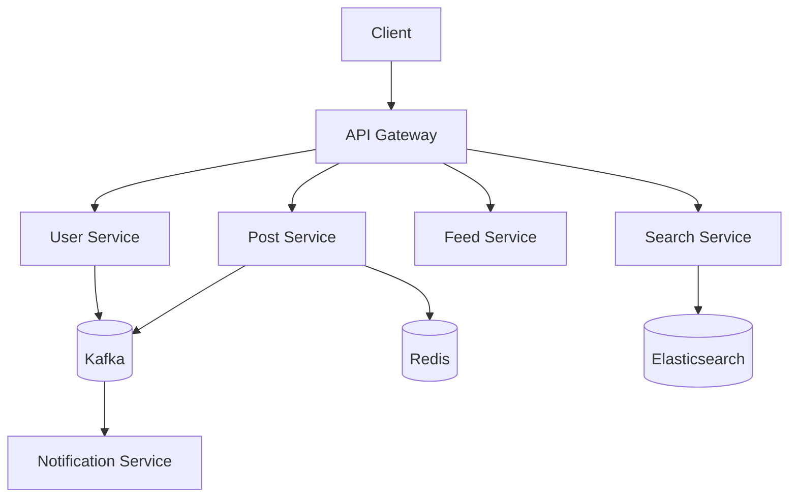

# LinkedIn-Style Distributed Backend

A microservices-oriented backend project inspired by a professional networking platform. The repository is organized into independently structured Spring Boot services and an API gateway.

## Services

| Service | Responsibility (based on repository structure) |
|---|---|
| `api-gateway` | Entry point for routing client requests |
| `user-service` | User-domain service |
| `post-service` | Post-domain service |
| `feed-service` | Feed functionality |
| `notification-service` | Notification functionality |
| `search-service` | Search functionality |

## Technology

- Java and Spring Boot (Maven projects)
- Redis
- Elasticsearch
- Apache Kafka
- Docker Compose

## High-level architecture





The diagram is a conceptual view of the service boundaries and infrastructure indicated by the repository. Verify the actual event flows and cache/search integrations against the implementation as the project evolves.

## Repository layout

```text
.
├── api-gateway/
├── user-service/
├── post-service/
├── feed-service/
├── notification-service/
├── search-service/
├── docker-compose.yml
└── High_level_design.png
```

## Run locally

Requirements: Java (matching each module's Maven configuration), Docker and Docker Compose.

Start infrastructure configured in the compose file:

```bash
docker compose up -d
```

Each service is an independent Maven project. From a service directory:

```bash
./mvnw spring-boot:run
```

On Windows, use `mvnw.cmd spring-boot:run`. Start infrastructure and dependent services before launching services that rely on them.

## Engineering roadmap

- Document each service's port, API routes and environment variables.
- Add API examples and request/response schemas.
- Document Kafka topics, event contracts and delivery guarantees.
- Define Redis key strategy, TTLs and cache invalidation.
- Document Elasticsearch mappings and indexing lifecycle.
- Add health checks, integration tests and observability.
- Provide a single local development profile with safe example configuration.

## Author

**Sandeep Kumar** · [GitHub](https://github.com/Sandeep-kumar-IITR)
